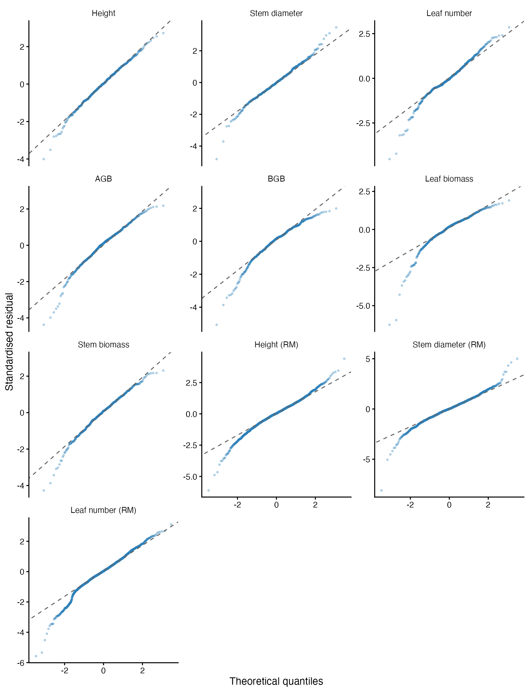
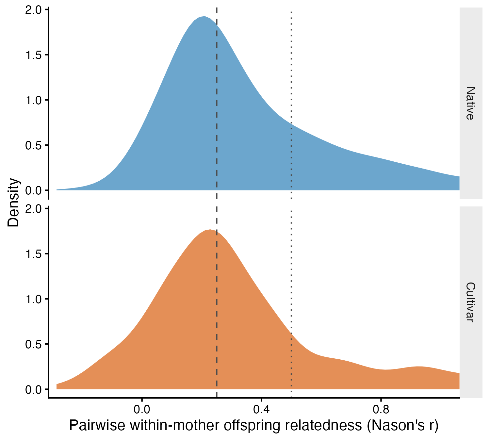

# Supplementary Materials

# Methods

The first part (Model Structure through Sensitivity Analyses) supports the Cultivar Impact Analysis subsection of the Methods and includes model equations, variance-component and heritability derivations, diagnostic procedures, and sensitivity analyses. Two short sections follow: a test of whether seedlings from the two native collection sites could be pooled (Native Collection Site), and diversity statistics and validation for the microsatellite marker panel (Marker Panel Diversity and Validation). The second part (Multilocus Linkage Disequilibrium through Summary of Marker Analyses) provides full detail for three supplementary marker-based analyses referenced in the Discussion: a test for non-random multilocus allelic association (linkage disequilibrium) between the native and cultivar groups, a discriminant analysis of principal components (DAPC) testing whether native and cultivar maternal trees separate on their full multilocus genotype, and a comparison of pairwise relatedness among native and cultivar maternal trees. These analyses complement the individual-allele-sharing approach (Admixture Percentage, AP) used in the main text, which considers each of the nine microsatellite loci independently. A final section (Realized Within-Mother Offspring Relatedness and Heritability) re-expresses heritability estimates under realized, rather than assumed, relatedness within maternal families. Annotated analysis code and the underlying data are available in the online supplementary materials.

## Model Structure

We used two general mixed-effects model forms, depending on whether we measured a trait once per individual or repeatedly across the study.

Germination date (GD), seedling survival (SS), and the traits measured at harvest (AGB, BGB, leaf biomass, stem biomass) were modeled as:

$y_{ijk} = \mu + Days + Sw + Family_{j} + Origin_{k} + \varepsilon_{ijk}$

where $y_{ijk}$ is the trait value of the $i^{th}$ individual from the $j^{th}$ maternal family (Family) and the $k^{th}$ origin class (Origin). Fixed effects included the scaled developmental time since germination (Days, a proxy for germination timing that accounts for differences in developmental stage at measurement; omitted when the response variable was GD itself) and the scaled mean seed weight of the $j^{th}$ maternal family ($S_{w}$, to account for maternal provisioning effects). Random effects were maternal family (Family) and origin (Origin), with residual error $\varepsilon_{ijk}$. We fit survival under the same general structure, using a binomial error distribution and a logit link rather than a Gaussian residual.

Height, stem diameter, and number of leaves were measured at the beginning and end of each growing season and were modeled with a repeated-measures extension:

$y_{ijkm} = \mu + Days + Sw + Time_{m} + Plant_{i} + Family_{j} + Origin_{k} + \varepsilon_{ijkm}\quad\quad\quad\quad(2)$

which adds a fixed effect of census occasion (Time) and a random effect of individual plant (Plant) to account for repeated sampling of the same seedlings.

Random effects were assumed independent and normally distributed:

$Family_{j} \sim N(0,\sigma_{family}^{2}),\quad Origin_{k} \sim N(0,\sigma_{origin}^{2}),\quad Plant_{i} \sim N(0,\sigma_{plant}^{2}),\quad\varepsilon \sim N(0,\sigma^{2})\quad\quad(3)$

We represented cultivar ancestry in two ways: the binary maternal-location Origin classification (a random effect) and the continuous Admixture Percentage (AP; a fixed covariate)—and modeled each trait separately under both, allowing us to compare inference across classification schemes.

Missing maternal seed weights ($n = 1$ maternal tree, 14 cultivar-origin seedlings; $n = 8$ maternal trees, 61 native-origin seedlings) were imputed using the origin-specific mean seed weight, which reduces variance in seed weight among affected families and should be considered conservative for detecting seed-weight effects.

## Model Comparison

For each trait, we compared a fixed-effects-only model, a model adding Family as a random effect, and a model adding both Family and Origin, using Akaike Information Criterion (AIC and, for the small samples, AICc), and calculated Akaike weights across the candidate set (Table S7). For the admixture-based analysis, the candidate set was the Family model with and without AP as a fixed covariate. Models within $\Delta AIC \leq 2$ were treated as having comparable empirical support; where no single model was clearly preferred, we report variance and heritability estimates under both variance decompositions rather than selecting a single "best" model (see Results). We fit models compared by AIC using maximum likelihood; we estimated final variance-component and heritability estimates from models fit using restricted maximum likelihood (REML).

## Variance Partitioning and Heritability Estimation

We extracted variance components for origin, maternal family, and residual variation from each fitted model using VarCorr (lme4; Bates et al. 2015). We assumed a half-sib design, under which additive genetic variance equals four times the maternal-family variance component ($V_{A} = 4V_{family}$). We estimated total phenotypic variance as $V_{P} = V_{origin} + V_{family} + V_{residual}$ across origin classes and $V_{P}(s) = V_{family}(s) + V_{residual}(s)$ within each origin class $s$. We calculated the proportion of phenotypic variance attributed to each random effect by dividing that component by the corresponding total.

Narrow-sense heritability was estimated as:

$h^{2} = \frac{4V_{family}}{V_{P}},\quad\quad\quad\quad\quad\quad h^{2}(s) = \frac{4V_{family}(s)}{V_{P}(s)}\quad\quad\quad\quad\quad\quad\quad\quad\quad\quad(4)$

We estimated survival heritability on the latent liability scale, with residual variance fixed at the distribution-specific value $\pi^{2}/3 = 3.29$ (Gilmour et al. 1985), following the same general form.

For the repeated-measures models, $V_{P}$ additionally included the among-plant variance component $V_{plant}$. We obtained 95% confidence intervals for variance components and heritability estimates from 1,000 parametric bootstrap replicates using bootMer (lme4; Bates et al. 2015). We evaluated the statistical significance of each random effect using likelihood-ratio tests (ranova, lmerTest; Kuznetsova et al. 2017) for the linear mixed models; the equivalent boundary-corrected test for the survival GLMM.

## Repeated-Measures Models

As an additional check on the growth-trait results (Results, Cultivar Impacts), we modeled the three traits measured repeatedly across both growing seasons: plant height, stem diameter, and number of leaves—under the repeated-measures structure described above (Model Structure), rather than using only the end-of-experiment value. These models reproduce the same pattern reported for the single end-of-experiment traits: origin adds little to model fit beyond maternal family (Table S8), and the confidence intervals for the origin variance component include zero for every trait (Table S9).

## Covariate Effects on Survival and Growth

Every model included two family-level covariates, developmental time since germination and the maternal family's mean seed weight, to account for early developmental and maternal provisioning effects (Model Structure). The main text summarizes their effects narratively (Results, Family-Level Variation and Trait Heritability); full trait-by-trait coefficient estimates, for the full sample and within each origin class, are given in Table S10.

## Model Diagnostics

For the linear mixed models, we assessed residual normality with normal quantile–quantile plots (Figure S1), homoscedasticity with residual-vs-fitted and scale–location plots, and group-level influence with leave-one-out Cook's distance on the fixed effects. We log-transformed response variables where these plots indicated right skew or non-constant variance. Formal Shapiro–Wilk tests rejected residual normality for most traits. At these sample sizes (*n* = 465–2021), the test detects small departures, and the Q–Q plots show that the central distribution of residuals is well behaved for every model; the departures are confined to the lower tail and reflect mild left-skew — a small number of unusually low residuals — most pronounced for below-ground and leaf biomass. The outlier-removal sensitivity analysis below was run specifically to check that these tail observations do not drive the variance-component estimates: the estimates are qualitatively unchanged and, where they shift, the maternal-family signal strengthens rather than weakens. The correlation between residual scale and fitted value was small for every model ($|r| \leq 0.17$), indicating no meaningful heteroscedasticity. Residual-vs-fitted, scale–location, and Q–Q panels for every model are available in the code repository.

For the generalized linear mixed models (survival), fit was assessed using simulation-based residual diagnostics (1,000 simulated residuals per model via simulateResiduals, DHARMa; Hartig 2016). Tests for residual uniformity, dispersion, and outliers were non-significant for the full sample and both origin subsets (all $p > 0.2$), except for a marginal outlier test in the cultivar subset ($p = 0.02$); we detected no meaningful violations of GLMM assumptions. We extracted family-specific conditional modes (BLUPs) from the cultivar-origin survival model using ranef (lme4; Bates et al. 2015) to visualize among-family variation in survival (Figure 2, Main Manuscript).

## Sensitivity Analyses

To assess the robustness of fixed- and random-effects inference, we refit each model after temporarily removing (a) individual-level outliers, identified by standardized residuals with $|z| > 3$, and (b) influential maternal families, identified by large Cook's distance values. Table S9 reports both refits for the repeated-measures models.

Removing outlier individual-level observations did not substantially change heritability estimates for most traits, and family-level random effects generally became slightly more significant; the largest shift was in below-ground biomass (*h^2^* = 0.23-0.36).

Removing the single most influential maternal family (identified by the largest leave-one-out Cook's distance on the fixed effects) affected variance-component and heritability estimates more than removing outlier individuals. For most growth traits, this family was urb09. For example, in the stem biomass model, removing urb09 reduced the family variance component (V~family~ = 0.046 - 0.016) and heritability (*h^2^* = 0.51 - 0.19) and weakened, but did not eliminate, support for the family random effect ($\chi^{2} = 5.3$, df $= 1$, $p = 0.022$).

## Native Collection Site

We sampled native-origin maternal trees from two forest sites: Pocahontas State Park and the VCU Rice Rivers Center. Before pooling them into a single native category (Sampling Design), we tested whether collection site affected survival and each growth trait, restricted to native-origin seedlings and controlling for germination timing, seed weight, and maternal family. No site effect was significant for any response (Table S1).

## Marker Panel Diversity and Validation

Basic diversity statistics for the nine cultivar-diagnostic microsatellite loci, maximum-likelihood estimates of null-allele frequency at each locus, and the composition of the cultivar voucher panel used as the reference key for admixture scoring (Genetic Analyses) are given in Tables S3–S5.

## Multilocus Linkage Disequilibrium (Index of Association)

AP and the comparison of the full nine-locus panel against the reduced six-locus panel of Wadl et al. (2008; Table S6) both examine individual alleles one locus at a time and found a diffuse pattern of allele sharing, with no sharp separation between the native and cultivar groups. This raises a different question: do the nine loci co-vary more than expected under random mating within a group, even though no single locus, or a simple sum across loci, separates the groups? Elevated multilocus linkage disequilibrium can arise from cryptic structure of exactly this kind and is also the standard signature used to detect clonal or partially clonal reproduction—relevant here because cultivars are clonally propagated.

We used the standardized index of association (${r‾}_{D}$, and the related $I_{A}$; Agapow and Burt 2001), with a 999-permutation test of the null hypothesis of linkage equilibrium (no multilocus association), implemented in poppr (Kamvar et al. 2014). This was computed for two datasets:

1.  **Maternal trees only** — the clean test. No two of these individuals are siblings, so any $I_{A}$ signal here cannot be a family or kinship artifact.

2.  **Maternal trees pooled with their offspring** — included for reference only. This dataset contains many maternal half- and full-sib families, and sibling groups are *expected* to show elevated multilocus association purely from shared parentage (a Wahlund-type effect of family structure), regardless of any cultivar signal. A positive result here, without a matching positive result in the maternal-only dataset, is not evidence of a native/cultivar effect.

We analyzed both datasets separately within each origin group (native, cultivar) and for the pooled/total sample (Table S11).

In the maternal-only dataset — the test unconfounded by family structure — neither the native nor the cultivar group showed evidence of multilocus linkage disequilibrium ($p > 0.2$ in both groups). The pooled dataset showed strongly significant linkage disequilibrium in both groups ($p \leq 0.001$), exactly as expected from the family (sibship) structure it contains rather than from any native/cultivar effect, and is reported here only to confirm that the test correctly detects the association it is known to be sensitive to. Judged from the maternal-only rows, we find no evidence of non-random multilocus allelic association distinguishing the native and cultivar groups.

## Discriminant Analysis of Principal Components (DAPC)

As a complementary multivariate test, we asked whether native and cultivar maternal trees separate on their full nine-locus genotype, considered jointly rather than locus by locus or linkage-by-linkage, using discriminant analysis of principal components (DAPC; Jombart et al. 2010). This analysis was restricted to the unrelated maternal trees for the same reason: no two of these individuals are siblings, so the results cannot reflect family structure.

DAPC can manufacture apparent group separation when too many principal-component axes are retained relative to sample size, since additional axes give the discriminant step more ways to fit idiosyncratic differences between arbitrarily labeled groups. We guarded against this in two ways. First, rather than fixing the number of retained axes by inspection, we selected it by cross-validation (xvalDapc, capped at a maximum of 20 axes given sample size), which chooses the number of axes that maximizes out-of-sample classification accuracy. Second, we assessed statistical significance by permutation rather than by treating any visual separation as evidence on its own: repeated (30 replicates) 80/20 stratified holdout classification accuracy was computed for the true native/cultivar labels, and this entire procedure was then repeated on 999 random relabelings of the same trees (holding the number of retained axes fixed) to build an empirical null distribution**.**

Cross-validation retained 14 of the 20 allowed principal-component axes — a large number relative to N = 28, and the regime in which DAPC is most prone to overfitting. Even so, observed classification accuracy (64.4%) fell below the no-information rate set by the class imbalance (67.9%; 19 of 28 trees are cultivar-origin) and was indistinguishable from the permutation null (permutation mean 60.0%, 95th percentile 72.2%, p = 0.273). That the test had ample room to overfit and still did not exceed chance strengthens, rather than weakens, the conclusion that native and cultivar maternal trees are not distinguishable on overall multilocus genotype at these nine loci.

## Pairwise Relatedness Among Maternal Trees

The origin classification used throughout the main text groups maternal trees by sampling location—native forest sites versus urban cultivar plantings—rather than by any direct measure of ancestry, so the two groups could differ in relatedness structure independent of cultivar status. We sampled native-origin mothers from only two nearby forest sites, while cultivar-origin mothers represent independently propagated named lines. Given evidence for isolation by distance in C. florida (Dyer et al. 2012), it is plausible a priori that native mothers are more closely related to one another than cultivar mothers are, and that this -- rather than a genuine origin effect -- could account for some of the asymmetry in family-level variance components reported in the main text (Results, Family-Level Variation and Trait Heritability).

We tested this using Nason's pairwise coancestry coefficient ($F_{ij}$, expressed on the relatedness scale as $r = 2F_{ij}$; gstudio; Dyer 2009), computed for all pairwise comparisons among the same genotyped maternal trees used in the linkage-disequilibrium and DAPC analyses above. Pairwise relatedness values are not independent; each individual contributes to multiple pairs, so we did not treat within-group pairs as independent samples. Instead, we permuted the native/cultivar origin label across the same individuals 9,999 times, holding the true group sizes (9 native, 19 cultivar) fixed. We recomputed the mean within-group relatedness and a two-sample Kolmogorov-Smirnov statistic between the within-native and within-cultivar relatedness distributions under each relabeling, giving an empirical null for both statistics without requiring the pairs to be independent.

Neither statistic showed evidence of a difference in relatedness structure between the two groups: neither the observed difference in mean pairwise relatedness (p = 0.672) nor the difference between the two within-group relatedness distributions (p = 0.887) exceeded what would be expected under random relabeling of the same 28 individuals. We therefore find no evidence that native-origin maternal trees are more closely related to one another than cultivar-origin maternal trees are, and conclude that the family-level variance asymmetry between origin groups reported in the main text is unlikely to reflect differential kinship structure between them.

## Summary of Marker Analyses

Together with the admixture-percentage comparisons in the main text (Results, Genetic Analysis), the three analyses above — examining correlation structure among loci, multivariate separability of the full genotype, and pairwise relatedness among maternal trees — find no evidence that native and cultivar maternal trees form distinguishable genetic groups, or differ systematically in relatedness, at these nine microsatellite loci. The following section addresses a related but separate question: not whether the two origin groups are genetically distinguishable, but how the heritability estimates reported throughout depend on the assumed relatedness within each maternal family.

## Realized Within-Mother Offspring Relatedness and Heritability

Every heritability estimate in the main text assumes open-pollinated maternal arrays are half-sib families ($r = 0.25$, so $h^{2} = 4V_{family}/V_{P}$), which the main text already flags as an upper-bound assumption (Results, Family-Level Variation and Trait Heritability): open pollination can mix in full-sib pairs (shared father, $r = 0.5$) within a mother's own offspring array, which would push the true relatedness-based multiplier below 4 (down to a floor of 2 if every pair were full sibs).

To gauge how much this matters in practice, we estimated realized pairwise relatedness (Nason's coancestry, $r = 2F_{ij}$; gstudio; Dyer 2009) among each mother's own genotyped offspring, restricted to offspring with a complete nine-locus genotype, and pooled all within-mother sibling pairs within each origin (native, cultivar) rather than averaging per mother first, since the question of interest is the shape of the realized relatedness distribution across each origin's half-sib arrays rather than any individual mother's estimate (Figure S2). We then re-expressed heritability for each trait's origin-specific family-variance estimate ($P_{family} = V_{family}/V_{P}$) as $h^{2} = P_{family}/r$, using each origin's pooled median realized relatedness in place of the assumed $r = 0.25$ (median rather than mean: with only nine loci, a minority of pairwise $F_{ij}$ estimates are noisy outliers well outside the biologically sensible \[0, 1\] range, which disproportionately distort the mean but not the median). The full method, including two gstudio-specific estimation pitfalls this avoids (a missing-genotype imputation bug and family-local rather than population-level reference allele frequencies), is documented in the analysis script 16_offspring_relatedness.R in the GitHub repository.

Across both origins and every trait, the realized-relatedness point estimate falls below the published half-sib value (Table S12), consistent with a modest admixture of full-sib pairs within maternal offspring arrays rather than a pure half-sib design; native traits whose family-variance estimate is already at or near zero (number of leaves, above-ground biomass, leaf biomass) are unaffected by the relatedness assumption, since $h^{2} = 0$ regardless of the divisor. This does not change the qualitative pattern reported in the main text — heritability differs more by origin than it does across relatedness assumptions within an origin — but it does confirm that the half-sib figures reported there are best read as upper bounds.

## Software

We performed all statistical analyses in R (version 4.5.3; R Core Team 2026). Mixed-effects models used lme4 (version 2.0.6; Bates et al. 2015), lmerTest (version 3.2.1; Kuznetsova et al. 2017), MuMIn (version 1.48.19) for AICc, and DHARMa (version 0.5.0; Hartig 2016) for GLMM diagnostics. Marker-based analyses used gstudio (version 1.14; Dyer 2009) and genepop (version 1.2.17; Rousset 2008) for exclusion probabilities and null-allele frequency estimation, poppr (version 2.9.8; Kamvar et al. 2014) for the multilocus linkage-disequilibrium analysis, and adegenet (version 2.1.11; Jombart 2008) for the DAPC analysis. Annotated code and data are available in the linked GitHub repository.

# Tables

Table S1: Test of native collection sites (Pocahontas State Park, 11 families / 147 seedlings; VCU Rice Rivers Center, 5 families / 27 seedlings) on survival and each growth trait, native-origin seedlings only. Each row is a likelihood-ratio test of a site fixed-effect term added to a model with germination timing, seed weight, and maternal family.

| **Response**         | ***n*** | **Site coefficient (SE)** | **χ²** | **df** | ***p*** |
|----------------------|---------|---------------------------|--------|--------|---------|
| Survival             | 174     | −0.424 (0.523)            | 0.640  | 1      | 0.424   |
| Plant height         | 138     | −0.026 (0.063)            | 0.169  | 1      | 0.681   |
| Stem diameter        | 138     | −0.047 (0.056)            | 0.698  | 1      | 0.403   |
| Number of leaves     | 137     | 0.131 (0.119)             | 1.215  | 1      | 0.270   |
| Above-ground biomass | 138     | −0.121 (0.158)            | 0.582  | 1      | 0.446   |
| Below-ground biomass | 138     | −0.222 (0.197)            | 1.259  | 1      | 0.262   |
| Leaf biomass         | 138     | −0.119 (0.223)            | 0.286  | 1      | 0.593   |
| Stem biomass         | 138     | −0.212 (0.146)            | 2.089  | 1      | 0.148   |

Table S2: Number of *Cornus florida* seedlings per maternal family at the start of the common garden (Beginning) and alive at the final census (End). Families are labeled by anonymized code (urb = cultivar origin, from managed landscapes; nat = native origin, from second-growth forest).

| **Origin** | **Family** | **Beginning** | **End** |  | **Origin** | **Family** | **Beginning** | **End** |
|----|----|----|----|----|----|----|----|----|
| Cultivar | urb01 | 16 | 12 |  | Cultivar | urb24 | 16 | 13 |
| Cultivar | urb03 | 28 | 27 |  | Cultivar | urb25 | 22 | 19 |
| Cultivar | urb04 | 25 | 21 |  | Cultivar | urb26 | 17 | 15 |
| Cultivar | urb07 | 24 | 20 |  | Cultivar | urb28 | 22 | 20 |
| Cultivar | urb09 | 26 | 26 |  | Cultivar | urb29 | 13 | 8 |
| Cultivar | urb10 | 14 | 10 |  | Cultivar | urb31 | 23 | 19 |
| Cultivar | urb11 | 19 | 17 |  | Cultivar | urb32 | 20 | 19 |
| Cultivar | urb12 | 25 | 17 |  | Native | nat18 | 3 | 3 |
| Cultivar | urb13 | 15 | 11 |  | Native | nat19 | 41 | 28 |
| Cultivar | urb14 | 23 | 20 |  | Native | nat20 | 8 | 6 |
| Cultivar | urb17 | 16 | 14 |  | Native | nat21 | 10 | 9 |
| Cultivar | urb18 | 14 | 7 |  | Native | nat22 | 14 | 13 |
| Cultivar | urb23 | 17 | 15 |  | Native | nat23 | 9 | 7 |
| Native | nat24 | 5 | 4 |  | Native | nat29 | 14 | 14 |
| Native | nat25 | 7 | 6 |  | Native | nat30 | 8 | 4 |
| Native | nat26 | 17 | 16 |  | Native | nat31 | 3 | 2 |
| Native | nat27 | 16 | 10 |  | Native | nat32 | 10 | 7 |
| Native | nat28 | 6 | 6 |  | Native | nat33 | 3 | 3 |

Totals: 395 cultivar-origin seedlings (20 families), 174 native-origin seedlings (16 families); 569 seedlings total, 468 alive at the final census.

Table S3: Diversity of the nine cultivar-diagnostic microsatellite loci in the (A) maternal trees and in the (B) offspring arrays. Each group is evaluated for the number of alleles (A), effective number of alleles (Aₑ), observed and expected heterozygosity (Hₒ, Hₑ), inbreeding coefficient (F~IS~), and single-locus exclusion probability (Pₑ).

| **A. Maternal Samples** |  |  |  |  |  |  |
|----|----|----|----|----|----|----|
| **Locus** | ***A*** | ***A*~ₑ~** | ***H*~ₒ~** | ***H*~ₑ~** | ***F*~IS~** | ***P*~ₑ~** |
| cf020 | 10 | 7.839 | 0.815 | 0.872 | 0.066 | 0.877 |
| cf125 | 5 | 3.424 | 0.714 | 0.708 | −0.009 | 0.681 |
| cf213 | 21 | 15.525 | 0.964 | 0.936 | −0.031 | 0.931 |
| cf273 | 9 | 2.330 | 0.643 | 0.571 | −0.126 | 0.582 |
| cf581 | 5 | 1.298 | 0.143 | 0.230 | 0.378 | 0.215 |
| cf585 | 15 | 9.278 | 0.929 | 0.892 | −0.041 | 0.881 |
| cf597 | 11 | 7.127 | 0.857 | 0.860 | 0.003 | 0.875 |
| cf634 | 11 | 6.222 | 0.750 | 0.839 | 0.106 | 0.841 |
| cf701 | 7 | 4.052 | 0.643 | 0.753 | 0.146 | 0.753 |
| all loci | 94 | 57.094 | 0.718 | 0.740 | 0.055 | — |
|  |  |  |  |  |  |  |
| **B. Offspring Samples** |  |  |  |  |  |  |
| **Locus** | ***A*** | ***A*~ₑ~** | ***H*~ₒ~** | ***H*~ₑ~** | ***F*~IS~** | ***P*~ₑ~** |
| cf020 | 14 | 8.143 | 0.795 | 0.877 | 0.094 | 0.877 |
| cf125 | 6 | 3.105 | 0.696 | 0.678 | −0.026 | 0.681 |
| cf213 | 27 | 14.342 | 0.902 | 0.930 | 0.031 | 0.931 |
| cf273 | 10 | 2.397 | 0.566 | 0.583 | 0.028 | 0.582 |
| cf581 | 5 | 1.271 | 0.196 | 0.213 | 0.082 | 0.215 |
| cf585 | 20 | 8.305 | 0.772 | 0.880 | 0.122 | 0.881 |
| cf597 | 15 | 8.032 | 0.787 | 0.875 | 0.101 | 0.875 |
| cf634 | 14 | 6.277 | 0.813 | 0.841 | 0.032 | 0.841 |
| cf701 | 12 | 4.045 | 0.697 | 0.753 | 0.074 | 0.753 |
| all loci | 123 | 55.917 | 0.692 | 0.737 | 0.060 | — |

Table S4: Maximum-likelihood estimates of null-allele frequency per locus for the cultivar- and native-origin samples (genepop; Rousset 2008), with 95% confidence intervals. We exclude a locus from the reduced marker panel when its confidence interval excludes zero in both origin classes. Multilocus exclusion probability (gstudio; Dyer 2009): full nine-locus panel P~excl~ = 1.00; reduced six-locus panel (cf125, cf213, cf273, cf581, cf585, cf701) P~excl~ = 0.99979.

| **Locus** | **Cultivar** | **Native** | **In reduced panel** |
|----|----|----|----|
| cf020 | 0.039 \[0.017, 0.065\] | 0.119 \[0.073, 0.181\] | no |
| cf125 | 0.015 \[0.000, 0.050\] | 0.000 (no CI) | yes |
| cf213 | 0.021 \[0.005, 0.042\] | 0.000 (no CI) | yes |
| cf273 | 0.029 \[0.008, 0.060\] | 0.018 \[0.000, 0.071\] | yes |
| cf581 | 0.013 \[0.000, 0.060\] | 0.077 \[0.022, 0.138\] | yes |
| cf585 | 0.068 \[0.044, 0.096\] | 0.000 (no CI) | yes |
| cf597 | 0.036 \[0.016, 0.061\] | 0.050 \[0.011, 0.102\] | no |
| cf634 | 0.022 \[0.003, 0.047\] | 0.120 \[0.071, 0.187\] | no |
| cf701 | 0.028 \[0.004, 0.056\] | 0.009 (no CI) | yes |

Table S5: Named cultivar accessions genotyped as the reference voucher panel for admixture scoring, sorted alphabetically.

| **Accession**        |
|----------------------|
| *Appalachian Blush*  |
| *Appalachian Joy*    |
| *Appalachian Mist*   |
| *Appalachian Snow*   |
| *Appalachian Spring* |
| *Cherokee Brave*     |
| *Cherokee Chief*     |
| *Cherokee Princess*  |
| *Cloud Nine*         |
| *Cornus Hyperion*    |
| *Double Pink*        |
| *Little Princess*    |
| *Plena*              |
| *Red Beauty*         |
| *Red Pygmy*          |
| *Rubra*              |
| *Rubra Pink*         |
| *Spring Grove*       |
| *Stellar Pink*       |

Table S6: Admixture Percentage (AP), summarized separately for maternal trees and their offspring array, computed from the full nine-locus panel versus the six-locus subset reported by Wadl et al. (2008), which includes their four-locus cultivar lineage-identification key (cf213, cf581, cf585, cf597).

| **Group** | **Marker set** | **n** | **Mean AP (%)** | **SD** | **Range (%)** |
|-----------|----------------|-------|-----------------|--------|---------------|
| Maternal  | full (9 loci)  | 28    | 49.8            | 11.9   | 33.3–88.9     |
| Offspring | full (9 loci)  | 397   | 50.4            | 8.9    | 27.8–75.0     |
| Maternal  | Wadl (6 loci)  | 28    | 53.3            | 11.0   | 33.3–91.7     |
| Offspring | Wadl (6 loci)  | 397   | 54.0            | 10.6   | 25.0–100.0    |

Table S7: Comparison of mixed-effects models for the end-of-experiment growth traits, by AIC and AICc. Candidate models: fixed effects only (germination timing + seed weight), + maternal family, + family and origin (origin as a random effect). For the AP subset (seedlings with a genotype), we compare the family model with and without Admixture Percentage as a fixed covariate. Native and Cultivar subsets are split by maternal-tree location. Models are compared by maximum likelihood.

\(A\) Plant height

| **Subset** | **Model** | **AIC** | **ΔAIC** | ***w*AIC** | **AICc** | **ΔAICc** | ***w*AICc** |
|----|----|----|----|----|----|----|----|
| Total | origin + family | −28.579 | 0.000 | 0.639 | −28.397 | 0.000 | 0.633 |
| Total | family | −27.434 | 1.146 | 0.361 | −27.304 | 1.093 | 0.367 |
| Total | fixed only | 15.898 | 44.478 | 0.000 | 15.985 | 44.382 | 0.000 |
| AP | AP + family | −21.695 | 0.000 | 0.529 | −21.469 | 0.000 | 0.521 |
| AP | family | −21.462 | 0.233 | 0.471 | −21.301 | 0.168 | 0.479 |
| Native | fixed only | 3.351 | 0.000 | 0.695 | 3.652 | 0.000 | 0.711 |
| Native | family | 4.997 | 1.646 | 0.305 | 5.452 | 1.800 | 0.289 |
| Cultivar | family | −40.918 | 0.000 | 0.999 | −40.733 | 0.000 | 0.999 |
| Cultivar | fixed only | −27.009 | 13.909 | 0.001 | −26.886 | 13.847 | 0.001 |

\(B\) Stem diameter

| **Subset** | **Model** | **AIC** | **ΔAIC** | ***w*AIC** | **AICc** | **ΔAICc** | ***w*AICc** |
|----|----|----|----|----|----|----|----|
| Total | family | −120.778 | 0.000 | 0.698 | −120.648 | 0.000 | 0.702 |
| Total | origin + family | −118.778 | 2.000 | 0.257 | −118.596 | 2.052 | 0.252 |
| Total | fixed only | −115.276 | 5.502 | 0.045 | −115.189 | 5.459 | 0.046 |
| AP | family | −116.555 | 0.000 | 0.703 | −116.395 | 0.000 | 0.709 |
| AP | AP + family | −114.835 | 1.720 | 0.297 | −114.610 | 1.785 | 0.291 |
| Native | fixed only | −10.576 | 0.000 | 0.731 | −10.275 | 0.000 | 0.746 |
| Native | family | −8.576 | 2.000 | 0.269 | −8.121 | 2.154 | 0.254 |
| Cultivar | family | −117.136 | 0.000 | 0.817 | −116.951 | 0.000 | 0.813 |
| Cultivar | fixed only | −114.138 | 2.997 | 0.183 | −114.015 | 2.935 | 0.187 |

\(C\) Number of leaves

| **Subset** | **Model** | **AIC** | **ΔAIC** | ***w*AIC** | **AICc** | **ΔAICc** | ***w*AICc** |
|----|----|----|----|----|----|----|----|
| Total | family | 742.013 | 0.000 | 0.609 | 742.144 | 0.000 | 0.611 |
| Total | origin + family | 744.013 | 2.000 | 0.224 | 744.197 | 2.053 | 0.219 |
| Total | fixed only | 744.606 | 2.593 | 0.167 | 744.693 | 2.549 | 0.171 |
| AP | family | 605.483 | 0.000 | 0.645 | 605.646 | 0.000 | 0.652 |
| AP | AP + family | 606.676 | 1.192 | 0.355 | 606.904 | 1.258 | 0.348 |
| Native | fixed only | 198.909 | 0.000 | 0.731 | 199.212 | 0.000 | 0.746 |
| Native | family | 200.909 | 2.000 | 0.269 | 201.367 | 2.155 | 0.254 |
| Cultivar | family | 545.847 | 0.000 | 0.873 | 546.033 | 0.000 | 0.869 |
| Cultivar | fixed only | 549.701 | 3.854 | 0.127 | 549.825 | 3.792 | 0.131 |

\(D\) Above-ground biomass

| **Subset** | **Model** | **AIC** | **ΔAIC** | ***w*AIC** | **AICc** | **ΔAICc** | ***w*AICc** |
|----|----|----|----|----|----|----|----|
| Total | origin + family | 908.434 | 0.000 | 0.682 | 908.617 | 0.000 | 0.676 |
| Total | family | 909.958 | 1.524 | 0.318 | 910.088 | 1.471 | 0.324 |
| Total | fixed only | 931.516 | 23.082 | 0.000 | 931.602 | 22.986 | 0.000 |
| AP | family | 738.513 | 0.000 | 0.729 | 738.674 | 0.000 | 0.736 |
| AP | AP + family | 740.497 | 1.984 | 0.271 | 740.723 | 2.049 | 0.264 |
| Native | fixed only | 273.607 | 0.000 | 0.731 | 273.908 | 0.000 | 0.746 |
| Native | family | 275.607 | 2.000 | 0.269 | 276.062 | 2.154 | 0.254 |
| Cultivar | family | 627.096 | 0.000 | 0.976 | 627.282 | 0.000 | 0.975 |
| Cultivar | fixed only | 634.523 | 7.427 | 0.024 | 634.646 | 7.364 | 0.025 |

\(E\) Below-ground biomass

| **Subset** | **Model** | **AIC** | **ΔAIC** | ***w*AIC** | **AICc** | **ΔAICc** | ***w*AICc** |
|----|----|----|----|----|----|----|----|
| Total | family | 1067.096 | 0.000 | 0.683 | 1067.227 | 0.000 | 0.688 |
| Total | origin + family | 1068.654 | 1.557 | 0.313 | 1068.837 | 1.610 | 0.308 |
| Total | fixed only | 1077.354 | 10.258 | 0.004 | 1077.441 | 10.214 | 0.004 |
| AP | family | 857.423 | 0.000 | 0.731 | 857.584 | 0.000 | 0.737 |
| AP | AP + family | 859.423 | 2.000 | 0.269 | 859.649 | 2.065 | 0.263 |
| Native | fixed only | 335.546 | 0.000 | 0.731 | 335.847 | 0.000 | 0.746 |
| Native | family | 337.546 | 2.000 | 0.269 | 338.000 | 2.154 | 0.254 |
| Cultivar | family | 721.340 | 0.000 | 0.829 | 721.526 | 0.000 | 0.825 |
| Cultivar | fixed only | 724.497 | 3.157 | 0.171 | 724.621 | 3.095 | 0.175 |

\(F\) Leaf biomass

| **Subset** | **Model** | **AIC** | **ΔAIC** | ***w*AIC** | **AICc** | **ΔAICc** | ***w*AICc** |
|----|----|----|----|----|----|----|----|
| Total | origin + family | 1239.516 | 0.000 | 0.918 | 1239.699 | 0.000 | 0.916 |
| Total | family | 1244.455 | 4.938 | 0.078 | 1244.585 | 4.886 | 0.080 |
| Total | fixed only | 1250.497 | 10.981 | 0.004 | 1250.583 | 10.885 | 0.004 |
| AP | family | 1016.455 | 0.000 | 0.657 | 1016.616 | 0.000 | 0.664 |
| AP | AP + family | 1017.752 | 1.297 | 0.343 | 1017.978 | 1.362 | 0.336 |
| Native | fixed only | 368.745 | 0.000 | 0.731 | 369.046 | 0.000 | 0.746 |
| Native | family | 370.745 | 2.000 | 0.269 | 371.200 | 2.154 | 0.254 |
| Cultivar | fixed only | 864.652 | 0.000 | 0.571 | 864.775 | 0.000 | 0.579 |
| Cultivar | family | 865.226 | 0.575 | 0.429 | 865.412 | 0.637 | 0.421 |

\(G\) Stem biomass

| **Subset** | **Model** | **AIC** | **ΔAIC** | ***w*AIC** | **AICc** | **ΔAICc** | ***w*AICc** |
|----|----|----|----|----|----|----|----|
| Total | family | 826.163 | 0.000 | 0.597 | 826.293 | 0.000 | 0.603 |
| Total | origin + family | 826.948 | 0.785 | 0.403 | 827.131 | 0.838 | 0.397 |
| Total | fixed only | 856.894 | 30.731 | 0.000 | 856.981 | 30.688 | 0.000 |
| AP | family | 660.622 | 0.000 | 0.729 | 660.783 | 0.000 | 0.736 |
| AP | AP + family | 662.604 | 1.982 | 0.271 | 662.830 | 2.047 | 0.264 |
| Native | fixed only | 253.847 | 0.000 | 0.731 | 254.147 | 0.000 | 0.746 |
| Native | family | 255.847 | 2.000 | 0.269 | 256.301 | 2.154 | 0.254 |
| Cultivar | family | 566.636 | 0.000 | 0.999 | 566.823 | 0.000 | 0.999 |
| Cultivar | fixed only | 580.704 | 14.068 | 0.001 | 580.828 | 14.005 | 0.001 |

Table S8: Comparison of repeated-measures models for plant height, stem diameter, and number of leaves across four censuses (start and end of each growing season). Candidate models: fixed only (germination timing + seed weight, no random effects); + individual plant; + plant and family; + plant and origin; + plant, family, and origin. Models compared by maximum likelihood.

\(A\) Plant height

| **Model** | **AIC** | **ΔAIC** | ***w*AIC** | **AICc** | **ΔAICc** | ***w*AICc** |
|----|----|----|----|----|----|----|
| plant + family | −915.247 | 0.000 | 0.517 | −915.158 | 0.000 | 0.520 |
| plant + family + origin | −915.109 | 0.138 | 0.483 | −915.000 | 0.158 | 0.480 |
| plant + origin | −858.968 | 56.279 | 0.000 | −858.879 | 56.279 | 0.000 |
| plant | −801.361 | 113.887 | 0.000 | −801.289 | 113.869 | 0.000 |
| fixed only | −96.875 | 818.372 | 0.000 | −96.820 | 818.338 | 0.000 |

\(B\) Stem diameter

| **Model** | **AIC** | **ΔAIC** | ***w*AIC** | **AICc** | **ΔAICc** | ***w*AICc** |
|----|----|----|----|----|----|----|
| plant + family | −1389.793 | 0.000 | 0.731 | −1389.703 | 0.000 | 0.733 |
| plant + family + origin | −1387.793 | 2.000 | 0.269 | −1387.683 | 2.020 | 0.267 |
| plant | −1346.875 | 42.918 | 0.000 | −1346.803 | 42.900 | 0.000 |
| plant + origin | −1346.362 | 43.431 | 0.000 | −1346.272 | 43.431 | 0.000 |
| fixed only | −1062.438 | 327.355 | 0.000 | −1062.382 | 327.321 | 0.000 |

\(C\) Number of leaves

| **Model** | **AIC** | **ΔAIC** | ***w*AIC** | **AICc** | **ΔAICc** | ***w*AICc** |
|----|----|----|----|----|----|----|
| plant + family | 2321.183 | 0.000 | 0.731 | 2321.278 | 0.000 | 0.733 |
| plant + family + origin | 2323.183 | 2.000 | 0.269 | 2323.299 | 2.021 | 0.267 |
| plant + origin | 2342.074 | 20.891 | 0.000 | 2342.169 | 20.891 | 0.000 |
| plant | 2342.144 | 20.961 | 0.000 | 2342.219 | 20.942 | 0.000 |
| fixed only | 2469.840 | 148.656 | 0.000 | 2469.898 | 148.621 | 0.000 |

Table S9: Variance components (origin, family, plant, residual — residual not shown), proportion of phenotypic variance, and narrow-sense heritability (*h²*) from the repeated-measures origin + family and family models, with 1000-replicate bootstrap 95% CIs, for the original data and after removing outlier observations (obs) or the most influential family (fam). Significance from ranova: · p \< 0.1, \* p \< 0.05, \*\* p \< 0.01, \*\*\* p \< 0.001.

| **Trait** | **Model** | **Sensitivity** | ***V*origin** | ***V*~family~** | ***V*~plant~** | ***h*²** |
|----|----|----|----|----|----|----|
| Plant height | origin + family | original | 0.021\* \[0.000, 0.111\] | 0.008\*\*\* \[0.004, 0.014\] | 0.023\*\*\* \[0.019, 0.027\] | 0.438 \[0.150, 0.849\] |
| Plant height | origin + family | obs | 0.019\* \[0.000, 0.098\] | 0.009\*\*\* \[0.004, 0.014\] | 0.020 \[0.017, 0.024\] | 0.517 \[0.185, 0.957\] |
| Plant height | origin + family | fam | 0.009 \[0.000, 0.052\] | 0.006\*\*\* \[0.002, 0.011\] | 0.023 \[0.019, 0.026\] | 0.381 \[0.137, 0.691\] |
| Plant height | family | original | — | 0.012\*\*\* \[0.006, 0.019\] | 0.023\*\*\* \[0.020, 0.027\] | 0.796 \[0.432, 1.158\] |
| Plant height | family | obs | — | 0.012\*\*\* \[0.006, 0.021\] | 0.021 \[0.018, 0.024\] | 0.926 \[0.508, 1.347\] |
| Plant height | family | fam | — | 0.007\*\*\* \[0.003, 0.013\] | 0.023 \[0.019, 0.026\] | 0.555 \[0.280, 0.882\] |
| Stem diameter | origin + family | original | 0.000 \[0.000, 0.006\] | 0.003\*\*\* \[0.001, 0.005\] | 0.010\*\*\* \[0.008, 0.012\] | 0.291 \[0.109, 0.496\] |
| Stem diameter | origin + family | obs | 0.001 \[0.000, 0.009\] | 0.003\*\*\* \[0.001, 0.004\] | 0.009 \[0.007, 0.010\] | 0.337 \[0.143, 0.556\] |
| Stem diameter | origin + family | fam | 0.002 \[0.000, 0.013\] | 0.002\*\*\* \[0.001, 0.004\] | 0.010 \[0.008, 0.012\] | 0.250 \[0.072, 0.452\] |
| Stem diameter | family | original | — | 0.003 \[0.001, 0.005\]\*\*\* | 0.010\*\*\* \[0.008, 0.012\] | 0.303 \[0.131, 0.524\] |
| Stem diameter | family | obs | — | 0.003 \[0.001, 0.005\]\*\*\* | 0.009 \[0.007, 0.010\] | 0.375 \[0.175, 0.595\] |
| Stem diameter | family | fam | — | 0.003 \[0.001, 0.005\]\*\*\* | 0.010 \[0.008, 0.012\] | 0.310 \[0.121, 0.534\] |
| Number of leaves | origin + family | original | 0.003 \[0.000, 0.030\] | 0.008\*\*\* \[0.001, 0.016\] | 0.043\*\*\* \[0.033, 0.055\] | 0.153 \[0.026, 0.296\] |
| Number of leaves | origin + family | obs | 0.004 \[0.000, 0.032\] | 0.008\*\*\* \[0.002, 0.015\] | 0.043 \[0.033, 0.054\] | 0.167 \[0.044, 0.311\] |
| Number of leaves | origin + family | fam | 0.008 \[0.000, 0.053\] | 0.007\*\*\* \[0.002, 0.015\] | 0.041 \[0.030, 0.053\] | 0.134 \[0.031, 0.263\] |
| Number of leaves | family | original | — | 0.009\*\*\* \[0.002, 0.017\] | 0.043\*\*\* \[0.032, 0.055\] | 0.164 \[0.044, 0.316\] |
| Number of leaves | family | obs | — | 0.009\*\*\* \[0.003, 0.017\] | 0.042 \[0.032, 0.054\] | 0.187 \[0.065, 0.353\] |
| Number of leaves | family | fam | — | 0.003· \[0.000, 0.008\] | 0.043 \[0.032, 0.054\] | 0.060 \[0.000, 0.152\] |

Table S10: Estimated effects of the two family-level covariates on survival (logit scale) and on each end-of-experiment growth trait (ln scale), from the family model, for the full sample and within each origin class. Cells give the coefficient (SE). Germination timing is scaled developmental time since germination (higher = earlier germination, more growing time before measurement); seed weight is the scaled maternal family mean. · p \< 0.1, \* p \< 0.05, \*\* p \< 0.01, \*\*\* p \< 0.001.

| **Response**         | **Subset** | **Germination timing** | **Seed weight**    |
|----------------------|------------|------------------------|--------------------|
| Survival             | Total      | +2.000 (0.241)\*\*\*   | −0.381 (0.162)\*   |
| Survival             | Native     | +1.480 (0.360)\*\*\*   | −1.036 (0.455)\*   |
| Survival             | Cultivar   | +2.336 (0.336)\*\*\*   | −0.503 (0.349)     |
| Plant height         | Total      | +0.095 (0.012)\*\*\*   | +0.030 (0.019)     |
| Plant height         | Native     | +0.150 (0.029)\*\*\*   | −0.016 (0.073)     |
| Plant height         | Cultivar   | +0.080 (0.013)\*\*\*   | −0.055 (0.031)·    |
| Stem diameter        | Total      | +0.087 (0.011)\*\*\*   | +0.001 (0.013)     |
| Stem diameter        | Native     | +0.134 (0.027)\*\*\*   | +0.022 (0.048)     |
| Stem diameter        | Cultivar   | +0.074 (0.011)\*\*\*   | −0.037 (0.023)     |
| Number of leaves     | Total      | −0.003 (0.027)         | −0.017 (0.032)     |
| Number of leaves     | Native     | −0.013 (0.059)         | −0.060 (0.102)     |
| Number of leaves     | Cultivar   | −0.004 (0.031)         | −0.026 (0.064)     |
| Above-ground biomass | Total      | +0.265 (0.032)\*\*\*   | +0.013 (0.045)     |
| Above-ground biomass | Native     | +0.359 (0.075)\*\*\*   | −0.081 (0.131)     |
| Above-ground biomass | Cultivar   | +0.237 (0.035)\*\*\*   | −0.188 (0.076)\*   |
| Below-ground biomass | Total      | +0.375 (0.039)\*\*\*   | +0.003 (0.049)     |
| Below-ground biomass | Native     | +0.576 (0.094)\*\*\*   | +0.074 (0.203)     |
| Below-ground biomass | Cultivar   | +0.324 (0.041)\*\*\*   | −0.190 (0.081)\*   |
| Leaf biomass         | Total      | +0.289 (0.046)\*\*\*   | −0.025 (0.056)     |
| Leaf biomass         | Native     | +0.386 (0.105)\*\*\*   | −0.174 (0.184)     |
| Leaf biomass         | Cultivar   | +0.256 (0.050)\*\*\*   | −0.289 (0.089)\*\* |
| Stem biomass         | Total      | +0.255 (0.030)\*\*\*   | +0.040 (0.044)     |
| Stem biomass         | Native     | +0.347 (0.070)\*\*\*   | −0.007 (0.148)     |
| Stem biomass         | Cultivar   | +0.230 (0.032)\*\*\*   | −0.142 (0.077)·    |

Table S11: Index of association ($I_{A}$) and standardized index of association (${r‾}_{D}$; Agapow and Burt 2001), with permutation-based p-values (999 permutations; poppr, Kamvar et al. 2014).

| **Dataset** | **Group** | **N** | $I_{A}$ | ***p* (**$I_{A}$**)** | ${r‾}_{D}$ | ***p* (**${r‾}_{D}$**)** |
|----|----|----|----|----|----|----|
| Maternal trees only (unrelated individuals) | Native | 9 | -0.116 | 0.607 | -0.016 | 0.613 |
| Maternal trees only (unrelated individuals) | Cultivar | 19 | 0.079 | 0.262 | 0.010 | 0.261 |
| Maternal trees only (unrelated individuals) | Total | 28 | -0.033 | 0.621 | -0.004 | 0.622 |
| Pooled maternal + offspring (family-structured) | Native | 95 | 0.215 | 0.001 | 0.027 | 0.001 |
| Pooled maternal + offspring (family-structured) | Cultivar | 254 | 0.197 | 0.001 | 0.025 | 0.001 |
| Pooled maternal + offspring (family-structured) | Total | 349 | 0.121 | 0.001 | 0.015 | 0.001 |

Table S12: Heritability re-expressed under realized within-mother offspring relatedness, bracketed by the half-sib ($r = 0.25$) and full-sib ($r = 0.5$) assumptions. $h_{dist}^{2}$ is the point estimate at each origin's pooled median pairwise relatedness among complete-genotype offspring (native median $r$ = 0.268, $n$ = 256 pairs among 8 mothers; cultivar median $r$ = 0.274, $n$ = 878 pairs among 18 mothers).

| **Trait** | **Origin** | **Half Sibling** | **Relatedness** | **Full Sibling** |
|----|----|----|----|----|
| Plant height | Native | 0.238 | 0.222 | 0.119 |
| Plant height | Cultivar | 0.474 | 0.432 | 0.237 |
| Stem diameter | Native | 0.008 | 0.007 | 0.004 |
| Stem diameter | Cultivar | 0.247 | 0.226 | 0.124 |
| Number of leaves | Native | 0.000 | 0.000 | 0.000 |
| Number of leaves | Cultivar | 0.263 | 0.239 | 0.131 |
| Above-ground biomass | Native | 0.000 | 0.000 | 0.000 |
| Above-ground biomass | Cultivar | 0.322 | 0.294 | 0.161 |
| Below-ground biomass | Native | 0.103 | 0.096 | 0.051 |
| Below-ground biomass | Cultivar | 0.233 | 0.213 | 0.117 |
| Leaf biomass | Native | 0.000 | 0.000 | 0.000 |
| Leaf biomass | Cultivar | 0.130 | 0.119 | 0.065 |
| Stem biomass | Native | 0.090 | 0.084 | 0.045 |
| Stem biomass | Cultivar | 0.438 | 0.399 | 0.219 |

# Figures

Figure S1: Normal quantile–quantile plots of the standardized residuals from the top-supported model of each trait: the seven end-of-experiment single-measurement traits and the three repeated-measures traits (RM). Points on the dashed line indicate normally distributed residuals. The central distribution is well behaved for every model; departures are confined to the lower tail (mild left-skew), most visible for below-ground and leaf biomass. Shapiro–Wilk tests reject normality for most models (see text).

Figure S2: Density of pairwise Nason relatedness ($r = 2F_{ij}$) among genotyped offspring within each mother's own array, pooled by origin. The dashed line marks the half-sib expectation ($r = 0.25$); the dotted line marks the full-sib expectation ($r = 0.5$). Native median $r$ = 0.268 ($n$ = 256 pairs among 8 mothers); cultivar median $r$ = 0.274 ($n$ = 878 pairs among 18 mothers). Both distributions sit slightly above the half-sib expectation and below the full-sib expectation, consistent with a mixture of half- and full-sib pairs within maternal offspring arrays.

# Supplementary Literature Cited

Agapow PM, Burt A (2001) Indices of multilocus linkage disequilibrium. Mol Ecol Notes 1:101–102. [*https://doi.org/10.1046/j.1471-8278.2000.00014.x*](https://doi.org/10.1046/j.1471-8278.2000.00014.x)

Bates D, Mächler M, Bolker B, Walker S (2015) Fitting linear mixed-effects models using lme4. J Stat Softw 67:1–48. [*https://doi.org/10.18637/jss.v067.i01*](https://doi.org/10.18637/jss.v067.i01)

Dyer RJ (2009) GeneticStudio: a suite of programs for spatial analysis of genetic-marker data. Mol Ecol Resour 9:110–113. [*https://doi.org/10.1111/j.1755-0998.2008.02384.x*](https://doi.org/10.1111/j.1755-0998.2008.02384.x)

Dyer RJ, Chan DM, Gardiakos VA, Meadows CA (2012) Pollination graphs: quantifying pollen pool covariance networks and the influence of intervening landscape on genetic connectivity in the North American understory tree, Cornus florida L. Landsc Ecol 27:239–251. [*https://doi.org/10.1007/s10980-011-9696-x*](https://doi.org/10.1007/s10980-011-9696-x)

Gilmour AR, Anderson RD, Rae AL (1985) The analysis of binomial data by a generalized linear mixed model. Biometrika 72:593–599

Hartig F (2016) DHARMa: residual diagnostics for hierarchical (multi-level/mixed) regression models. R package. [*https://doi.org/10.32614/CRAN.package.DHARMa*](https://doi.org/10.32614/CRAN.package.DHARMa)

Jombart T (2008) adegenet: a R package for the multivariate analysis of genetic markers. Bioinformatics 24:1403–1405. [*https://doi.org/10.1093/bioinformatics/btn129*](https://doi.org/10.1093/bioinformatics/btn129)

Jombart T, Devillard S, Balloux F (2010) Discriminant analysis of principal components: a new method for the analysis of genetically structured populations. BMC Genet 11:94. [*https://doi.org/10.1186/1471-2156-11-94*](https://doi.org/10.1186/1471-2156-11-94)

Kamvar ZN, Tabima JF, Grünwald NJ (2014) Poppr: an R package for genetic analysis of populations with clonal, partially clonal, and/or sexual reproduction. PeerJ 2:e281. [*https://doi.org/10.7717/peerj.281*](https://doi.org/10.7717/peerj.281)

Kuznetsova A, Brockhoff PB, Christensen RHB (2017) lmerTest package: tests in linear mixed effects models. J Stat Softw 82:1–26. [*https://doi.org/10.18637/jss.v082.i13*](https://doi.org/10.18637/jss.v082.i13)

R Core Team (2026) R: a language and environment for statistical computing. R Foundation for Statistical Computing, Vienna

Rousset F (2008) genepop'007: a complete re-implementation of the genepop software for Windows and Linux. Mol Ecol Resour 8:103–106. [*https://doi.org/10.1111/j.1471-8286.2007.01931.x*](https://doi.org/10.1111/j.1471-8286.2007.01931.x)

Wadl PA, Wang X, Trigiano AN, et al. (2008) Molecular identification keys for cultivars and lines of *Cornus florida* and *C. kousa* based on simple sequence repeat loci. J Am Soc Hortic Sci 133:783–793. [*https://doi.org/10.21273/JASHS.133.6.783*](https://doi.org/10.21273/JASHS.133.6.783)
